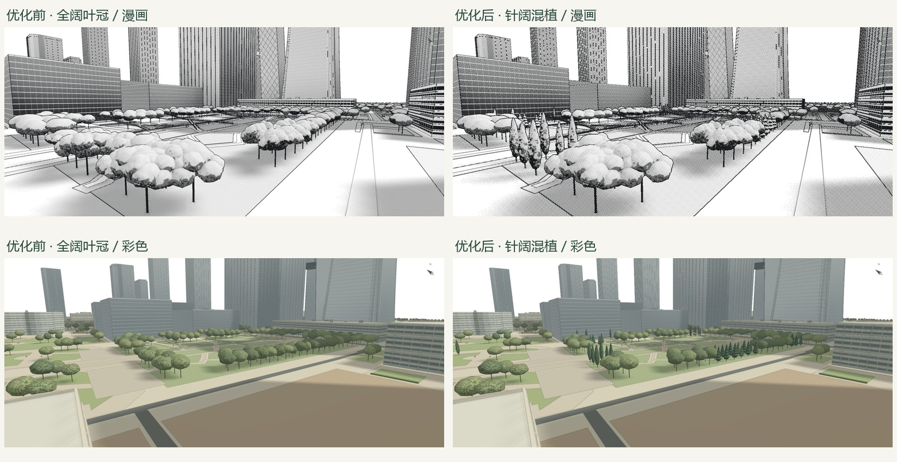
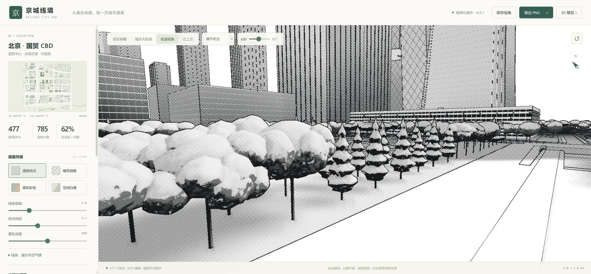

# 公园针叶混植 · v0.6.1

用户给出的原版截图中，细高尖冠、层叠枝冠与圆形阔叶冠共存。本轮将这类轮廓差异加入通用引擎，没有按北京坐标手摆树。

## 规则与数据来源

- 新增 `cypress` 细高柏形和 `conifer` 宽底层叠针叶形，两种闭合冠体各756三角；高度、宽深比、偏心、朝向与近景枝团随稳定种子变化。它们是示意树形，不是精确树种模型。
- 针叶远冠在任何距离保持尖顶和枝层，近处叠加小枝团；仍共享最多96棵近景细节预算，无透明贴片或额外后处理通道。两种针叶形最多增加两个实例化绘制批次，成本随渲染通道而增加。
- 公园、庭院与树林按短段/小片选树形，配色更深，保留阔叶树的连续遮荫带。未标注的道路行道树保持原有阔叶节奏。
- 单树、树列、绿地面保留并读取 `leaf_type`、`genus`、`species`。明确阔叶标签优先于装饰配比；明确针叶标签和已识别属名决定树形；`leaf_cycle=evergreen` 本身不触发针叶判断。参见 [OSM leaf_type 文档](https://wiki.openstreetmap.org/wiki/Key%3Aleaf_type)。
- 当前样本没有这些可用树种标签，全部463棵针叶形都属于景观推断，没有声称从鸟瞰照片恢复了真实植栽。

## 复用参数

比例见 [VEGETATION_MIX](../../src/vegetation-rules.js)。`planStreetLife(data, {vegetationMix: {'park-belt': 0.30, 'garden-court': 0.26}})` 可覆盖默认值；设为0只关闭该类区域的推断针叶混植，OSM明确针叶标签仍优先。

| 区域 | 默认针叶片组选择概率 |
|---|---:|
| 林地 | 38% |
| 公园边缘 | 30% |
| 庭院 | 26% |
| 空隙庭园 | 32% |
| 建筑前场 | 14% |
| 草坪边缘 | 12% |
| 退界绿带 | 8% |

这是片组选择概率，不承诺每个小地块都有同样比例。场地尺寸、净空、预算过滤之后，最终数量会变化。

## 验收

| 专项主观自评（10分） | v0.6.0 | v0.6.1 | 剩余差异 |
|---|---:|---:|---|
| 尖冠/针叶轮廓辨识 | 0 | 8 | 两类示意模型，枝层仍偏规则 |
| 绿地混植层次 | 4 | 7.5 | 小片聚集成立，尚无丰富的地区树种库 |
| 远景树形差异 | 6.5 | 8 | 尖冠保持，但极远处仍受像素分辨率限制 |

分数仅评价本次新增能力，由实现者自评，不是独立评分、植物学准确率或实景还原率。

- [112项测试通过](tests.txt)，[生产构建通过](build.txt)，浏览器漫画/彩色/远景检查无控制台错误。
- [几何审计](metrics.json)：车道、步道、禁种地面、建筑冠包络、远冠与车桥/步桥桥板相交检查均为0。测试另检查两种针叶冠的近/远景顶点在多种子、多个过渡权重下位于净空包络内。
- [树形统计](vegetation.json)：共5075棵，柏形235、层叠针叶形228；公园734棵中204棵针叶形，庭院480棵中147棵针叶形。比上一版少4棵是冠形改变后重新做净空过滤的结果。
- 远冠几何从914220增至1180188三角，约增加29%；本轮未测移动GPU帧率，不宣称性能不变。
- [相机记录](camera-checks.json)、[视角参数](views.json)、[截图尺寸与哈希](screenshot-manifest.json)可复核。三组对照视口均为1920×889，太阳、种子、机位、目标和FOV一致；旧版截图复用上一轮已保存的最终v0.6.0证据。

## 全尺寸截图

| 机位 | 优化前 | 优化后 |
|---|---|---|
| 漫画近景 | [旧](before/09-tree-close.jpg) | [新](after/09-tree-close.png) |
| 彩色公园 | [旧](before/02-grove-color.jpg) | [新](after/02-grove-color.png) |
| 全区远景 | [旧](before/05-overview-color.jpg) | [新](after/05-overview-color.png) |

[用户提供的原版参考](references/original-mixed-park.png)只用于观察视觉特征，未用作纹理或模型。
