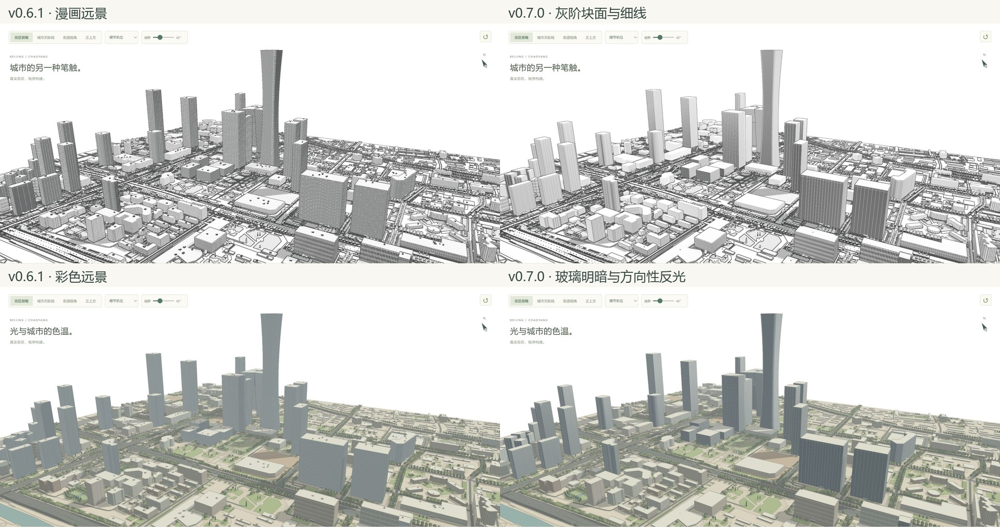
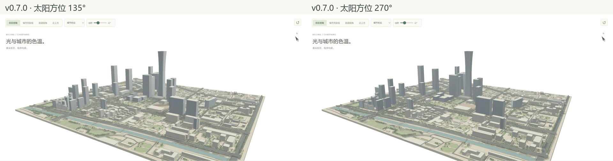
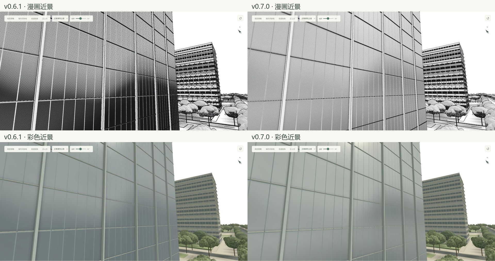

# 远景块面、屋顶细节与日照玻璃 · v0.7.0

这轮按用户给出的远景问题调整通用引擎：远处优先读出楼体轮廓、朝向和大面积反光；近处再读窗框、材质与网点。没有增加指定建筑、OSM ID 或北京坐标分支。

## 原因与实现

旧版已经过滤了远窗，但整面墙仍使用固定屏幕尺寸的网点；一座楼只剩几十像素宽时，网点反而成为最显眼的“纹理”。屋顶设备也一直保留完整几何和描边。玻璃反射的亮区原来使用固定方向，俯视时反射方向落到地面区后又缺少足够的明暗变化，导致大厦看起来都是淡蓝色。

| 需求 | 通用处理 | 涉及代码 |
|---|---|---|
| 远景建筑不再铺满同样的点阵 | 约0.35–1.25米/显示像素之间，建筑立面网点连续转为灰阶块面；保留轮廓、可辨识的宽竖带和横带 | `src/ink-renderer.js` |
| 远景玻璃仍有明确材质 | 窗格细墨线衰减时，保留平均玻璃覆盖率和大面积暗反射；窗格与材质明暗分别过滤 | `src/facade-shader.js` |
| 玻璃服从太阳和视角 | 接入场景太阳方位/高度；用反射方向、表面朝向、掠射角亮部和宽地平线反光带控制冷暖明暗；远处适度增强大块面的对比 | `src/facade-shader.js`、`src/main.js` |
| 屋顶不再遍布小黑块 | 按设备尺寸、相机距离、FOV和显示高度估计投影尺寸；10像素以下连续收缩，4像素以下收至屋面锚点，拉近恢复 | `src/distance-style.js`、`src/city.js` |
| 高分屏与多通道一致 | 网点简化按CSS显示像素判断；屋顶同一份几何用于颜色、法线、深度、分类和阴影；PNG导出按输出尺寸更新后恢复预览LOD | 渲染器与导出流程 |

玻璃是艺术化的程序环境反射：天空、地面暗部和太阳亮部的近似，没有追踪邻楼，也没有使用卫星图、HDR照片或真实反射探针。受光面可以偏暖亮，背光面偏冷暗；掠射方向可出现亮边，亮暗不会被一律平均成淡蓝。

## 太阳转向与近景

同一相机、同一太阳高度45°，只将太阳方位135°改为270°。玻璃的亮面、反光与场景阴影相应变化。

近景保留落地窗格、实体窗框和漫画网点，反光带比旧版更容易读到。此次未改树木或道路的渲染规则。

## 验收

| 专项主观自评（10分） | v0.6.1 | v0.7.0 | 仍可改善 |
|---|---:|---:|---|
| 远景建筑的干净程度 | 4 | 8.5 | 地面植被与路网仍较密，极远处仍有细线混叠 |
| 屋顶细节的主次 | 4 | 9 | 采用统一尺寸规则，未区别大型机房与小设备的重要性 |
| 彩色玻璃的体积与方向性反光 | 4.5 | 8 | 同朝向同类幕墙仍可能相似，尚无邻楼真实倒影 |
| 近景窗格与材质保留 | 8 | 8 | 仍是程序环境近似，未做物理反射精度评分 |

分数是实现者对本轮目标的自评，不是独立评审、原版相似率或实景准确率。

- [116项测试通过](tests.txt)，[生产构建通过](build.txt)。新增测试覆盖屋顶连续过渡及精确恢复、太阳实时共享、高分屏显示尺度，以及重新生成后的中性漫画材质同步。构建保留已有Three.js大分包提示。
- [浏览器错误记录](browser-errors.json)为空；检查漫画、彩色、近景、远景与太阳转向后的实际渲染。
- [屋顶几何审计](roof-lod.json)：525组设备中，全区俯瞰保留0组、城市机位3组、街区机位75组、近景机位268组。这里是LOD后仍有非零几何的组数，**不是屏幕可见组数**；视野外对象也参与统计。屋顶主体、女儿墙与大型建筑轮廓保持。
- 没有新增渲染通道。屋顶仍在合批网格内，收缩不等于移除GPU顶点开销；本轮没有测移动GPU帧率，不宣称性能提升。
- [实际导出的2400×1211 PNG](export-district-ink.png)已查看，含来源署名。浏览器下载事件等待超时，但文件已完成，随后从下载目录核验，记录见[导出检查](export-check.json)。导出分辨率更高时会恢复部分可解析的网点与屋顶细节，因此不是把预览截图直接放大。
- GLB保留当前几何LOD状态；程序反射/漫画后处理仍不属于标准GLB材质，不能期待外部查看器还原本引擎的画面。

## 可复核证据

旧版基线为`cb76ffc`的v0.6.1冻结构建。9组前后图均使用1920×889浏览器视口、相同数据和种子1，机位、目标、FOV、太阳及参数保存在[views.json](views.json)。截图前读取UI机位/模式/太阳值作校验，记录见[camera-checks.json](camera-checks.json)，文件尺寸及SHA-256见[screenshot-manifest.json](screenshot-manifest.json)。太阳转向组与自己的旧版对应组比较时方位均为270°。

| 机位 | 旧版 | 新版 |
|---|---|---|
| 街区漫画 | [图](before/district-ink.png) | [图](after/district-ink.png) |
| 街区彩色 | [图](before/district-color.png) | [图](after/district-color.png) |
| 城市漫画 | [图](before/city-ink.png) | [图](after/city-ink.png) |
| 城市彩色 | [图](before/city-color.png) | [图](after/city-color.png) |
| 城市太阳270° | [图](before/city-sun-270.png) | [图](after/city-sun-270.png) |
| 全区漫画 | [图](before/overview-ink.png) | [图](after/overview-ink.png) |
| 全区彩色 | [图](before/overview-color.png) | [图](after/overview-color.png) |
| 近景漫画 | [图](before/near-ink.png) | [图](after/near-ink.png) |
| 近景彩色 | [图](before/near-color.png) | [图](after/near-color.png) |

`node scripts/audit_distance.mjs`可重跑屋顶审计。`python scripts/distance_evidence.py`校验18张已保存截图，并拼合对照；它不控制浏览器，不生成或替换场景画面。用户提供的[漫画问题截图](references/user-ink.png)和[彩色问题截图](references/user-color.png)保留作为本轮问题来源。
