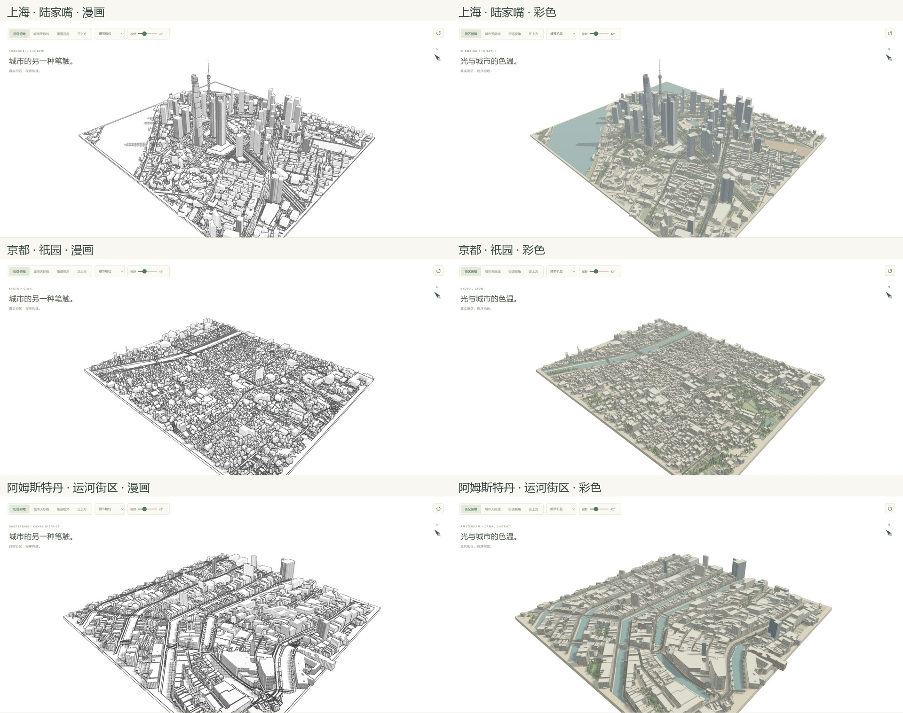
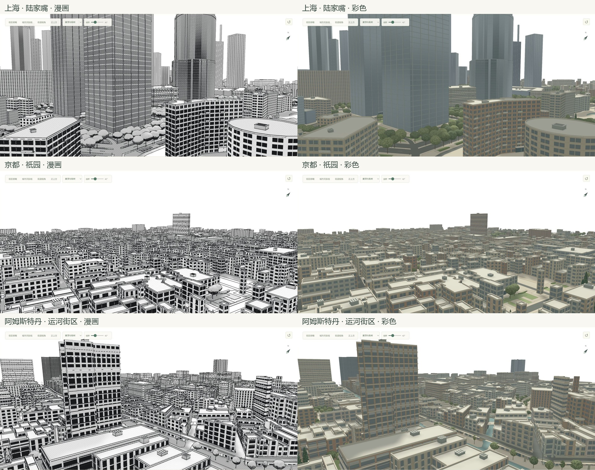

# 三地泛化验证 · v0.8.0

结论：这套引擎可以直接加载不同地区的OSM，生成可交互的漫画和彩色城市；高层商务区的迁移效果较好。**历史低层街区的地方风貌尚未通过验证**：高度估算、屋顶、街屋立面仍带有商务区原型的偏好。现在适合批量生成可审阅的原型，不宜直接宣称批量高还原。

本轮没有为新城市添加地标生成器、手摆树木或修改材质参数。只添加地点选择、独立数据入口、通用机位，并修复一个阻断京都加载的几何异常。三地均使用种子1、太阳135°/45°及v0.7的同一组漫画/玻璃参数。新地点使用同一套默认景观配置；北京保留原有补充数据和地区配置，不向其他地区混入。

## 直接查看

- [上海 · 陆家嘴](http://127.0.0.1:5178/?site=shanghai&v=0.8.0)
- [京都 · 祇园](http://127.0.0.1:5178/?site=kyoto&v=0.8.0)
- [阿姆斯特丹 · 运河街区](http://127.0.0.1:5178/?site=amsterdam&v=0.8.0)

以上链接需要本机预览服务运行。界面左上角也可切换地点；切换会清除上一地点的相机哈希，保存视角则保留当前地点查询参数。

## 数据与结果

数据通过[Overpass API](https://wiki.openstreetmap.org/wiki/Overpass_API/Overpass_QL)于2026-10-30下载，查询、WGS84范围、时间、来源及ODbL署名都保存在各原始文件的metadata中。计数单位是**建筑体块**，OSM分部单独计数，不等于独立楼栋数。高度覆盖率仅表示有高度或层数标签，并不认证其准确性。

| 样本 | 范围约 | 体块 | 道路对象 | 高度/层数覆盖 | 结果 |
|---|---|---:|---:|---:|---|
| 上海陆家嘴 | 2.0×1.8 km | 719 | 1,202 | 32.4% | 塔楼、河岸、绿地可直接生成；OSM分部带出一些分段轮廓，尚不能正确表现所有曲面、球体和塔冠 |
| 京都祇园 | 1.1×0.9 km | 4,460 | 1,016 | 3.3% | 密集路网、足迹能加载；97%左右体块依赖高度估算，平顶和普通楼房立面缺乏町家特征 |
| 阿姆斯特丹运河街区 | 0.8×0.8 km | 1,950 | 503 | 90.2% | 运河与连续街区排列清楚；少数估算高楼突出，山墙、坡屋顶和窄街屋立面缺失 |

三地的`landmarks`审计结果均为空：没有命中北京专用地标模型。上海出现分段塔楼是现有OSM `building:part`几何被通用体块生成器读取的结果，不表示已经实现上海地标专用模型。

## 暴露出的边界

### 1. 少量高度估算也能破坏整个天际线

阿姆斯特丹已知高度/层数体块的高度中位数为15.7米，但最高7个体块都是估算值。最高者`w266695079`为83.6米，周围150米内97个已知高度体块的中位数为16.2米。共24个估算体块超过附近已知高度中位数的两倍（邻居不少于5个）。这是异常筛查信号，并非逐栋实测证据，详见[高度审计](amsterdam-height-audit.json)。

原因可在`heightInfo()`直接定位：缺失高度的`commercial/office`仍随机估算8–22层，适合部分商务区，却会在旧城生成突兀高楼。京都虽有密集建筑轮廓，只有149个体块有高度或层数；通用估算决定了绝大多数视觉结果，不能把轮廓完整误认为三维资料完整。

### 2. 屋顶与地方立面是几何能力缺口

当前普通建筑主要挤出为平顶；`roof:shape`只影响部分设备布置，尚未生成对应坡面或山墙。本样本上海有33个、京都6个、阿姆斯特丹82个体块带`roof:shape`，即使标签存在，也还未充分利用。

祇园具有传统町家街屋，[日本国家旅游局的地区介绍](https://www.japan.travel/en/spot/84/)可作为建筑类型依据。阿姆斯特丹的窄地块节奏、窗型与多类山墙是重要特征，见[UNESCO城市遗产图集](https://whc.unesco.org/en/urban-heritage-atlas/Amsterdam/)。本轮截图中这些特征没有被表达，不能只靠换颜色补足。未以这些网页照片恢复任何逐栋几何。

### 3. 复杂地面几何会暴露数值问题

京都场地`osm:w430590712`的63条停车标线切割原先报`Unable to complete output ring`，导致整个城市构建中止。修复会先尝试原精度，再以1毫米、必要时1厘米网格统一场地与标线，裁去越界装饰；仍失败时保留源地面并省略该组装饰，记录计数。

这个实际失败样本现在在1毫米重试时成功：场地覆盖差异小于0.25平方米，保留超过25平方米有效标线；京都最终1次精度重试，0条因最终失败而省略的标线。回归样本保存在`test/fixtures/kyoto-paint-inlay.json`，不是按坐标特判。

### 4. 密集城市需要分块与合批

| 样本 | 本机Node构建耗时示例 | Mesh对象 | 当前视角三角数约 |
|---|---:|---:|---:|
| 上海 | 11.0 s | 766 | 244万 |
| 京都 | 29.1 s | 4,508 | 142万 |
| 阿姆斯特丹 | 35.4 s | 1,992 | 86万 |

这是CPU生成审计，受机器与同时运行的任务影响，不是浏览器首屏基准，也不是GPU帧率。京都每栋建筑仍有独立网格，阿姆斯特丹复杂轮廓/地面运算也有成本。三地顶点均为有限值，但尚未逐一核验桥高、交通层级、碰撞和移动GPU表现。边缘建筑可能跨出取样边界，`outsidePlanarVertices`仅作为诊断计数，不等于内部破洞数量。

## 主观评分与下一步

以下为实现者对本轮截图的10分制自评，不是独立评审或实景还原率，没有做逐栋实景对照。

| 项目 | 上海 | 京都 | 阿姆斯特丹 |
|---|---:|---:|---:|
| 漫画/彩色渲染可读性 | 8 | 6.5 | 7 |
| 街区布局辨识 | 8 | 7 | 8 |
| 建筑类型与地方风貌 | 6.5 | 2.5 | 3.5 |
| 可直接作为成品的程度 | 6.5 | 3 | 4.5 |

建议的通用引擎改进顺序：

1. **邻域高度估算与置信度**：真实高度、层数优先；缺失时结合相邻已知体块、用途和占地，避免商业用途直接触发高层；稀疏数据区域显式降低置信度。
2. **屋顶和街屋形体**：读取坡屋顶、屋脊方向、屋顶高度与分部；提供山墙、狭长连排、低层商住、木构外廊等可组合语法，通过标签/地区参数选择，而非按坐标写建筑。
3. **低层细节预算**：小屋顶设备、窗框与描边按街区密度、屏幕尺寸共同控制，避免密排街屋变成设备和窗格的噪声。
4. **分块、缓存、合批**：把“能生成单块”推进到可稳定扩展；保留对象来源与点选ID，降低密集地区的构建时间和绘制批次。

## 验证与复现

- [121项测试通过](tests.txt)、[生产构建通过](build.txt)。已实际操作地点选择器，依次切换京都→阿姆斯特丹→上海→北京。
- [切回北京](beijing-regression.json)仍为477体块、785道路、62%高度/层数覆盖、5075树；原来的两份OSM补充和地区配置保持加载。
- 三地漫画/彩色、全景/局部共12张完整截图；[相机记录](camera-checks.json)、[视角参数](views.json)、[尺寸及SHA-256](screenshot-manifest.json)可复核，视口1920×889。
- [上海审计](shanghai.json)、[京都审计](kyoto.json)、[阿姆斯特丹审计](amsterdam.json)包含高度来源、地面、道路、树木和几何统计。[上海](shanghai-browser-errors.json)、[京都](kyoto-browser-errors.json)、[阿姆斯特丹](amsterdam-browser-errors.json)浏览器错误/警告记录为空。
- `node scripts/audit_regions.mjs shanghai kyoto amsterdam`重跑构建审计；`node scripts/audit_region_heights.mjs`重跑邻域高度检查；`python scripts/generalization_evidence.py`校验已保存截图并拼合对照。

原始文件是`public/data/shanghai-lujiazui.json`、`kyoto-gion.json`与`amsterdam-canals.json`。抓取命令为`python scripts/fetch_osm.py --bbox 南,西,北,东 --name 名称 --output 路径 --context`，范围保存在上述审计JSON中。三个样本属于不同城市形态的有限验证，不能外推为任意地区都已经通过。
