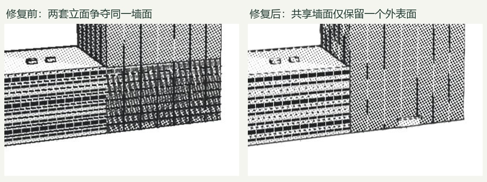

# v0.8.1 — 转动视角时的局部闪烁

本轮修复针对几何生成和渲染管线，未修改 OSM 原始坐标、高度或添加地点特判。基准为 `96ca89f` / v0.8.0。

## 已确认的原因及处理

| 位置 / 环节 | 证据 | 通用修复 |
|---|---|---|
| 国贸三期 B 底部 | `w916885302` 高 296 m，与 32 m 裙楼 `w660651176` 的两条边完全相同，长度 60.238 m、56.401 m；低处两套立面共面 | 对邻接建筑体块计算外露边界；内部墙、重复外墙、被高楼覆盖的低层屋顶不再重复生成；装饰条只跟随外露墙段 |
| 桥面 | 原结构顶面只比道路低 0.018 m | 路面独占顶面，桥梁结构只生成侧面、底面，侧面接至路面高度 |
| 车道线 | 原标线悬在沥青上方 0.018–0.020 m | 标线从所在路面扣出并嵌入，沿实际宿主坡度生成；两者不重叠 |
| 远处近共面细节 | 相机 near 由海拔推算，最多 12 m；远距离深度量化误差增大 | 根据相机到实际几何包围盒的保守距离设置 near，保持距最近几何至少 5 倍余量；排除已被建筑包围盒覆盖的合并屋顶设备盒 |
| 屋顶、栏杆与细边 | 颜色和光照有 MSAA，法线没有；最终描边也未经抗锯齿 | 法线目标 4× MSAA，编号目标保持离散；新增仅作用于结构边缘附近的 FXAA resolve，整块网点和灰阶不做全屏模糊 |

代码提交：`33b46fc`（几何）、`c33ce94`（深度与描边），分别提交并分别推送。

## 动态验证

`scripts/stability-lab.html?fixture=tower` 使用两栋实际 OSM 建筑的隔离场景。固定目标位置，镜头在 ±1° 内按 0.1° 步长移动，共 21 帧；每帧投影同一面墙的 84 个世界坐标，读取颜色缓冲区的 3×3 像素平均线性亮度。

| 指标 | v0.8.0 | v0.8.1 |
|---|---:|---:|
| 84 个位置的亮度标准差中位数 | 0.030554 | 0.001052 |
| 标准差 P95 | 0.065330 | 0.006442 |
| 帧间总亮度范围超过 0.1 的位置 | 34 / 84 | 1 / 84 |

中位数下降 **96.6%**，P95 下降 **90.1%**。这是特定共面外墙的局部回归指标，且采样发生在漫画后处理之前，不能解读成全城市闪烁下降 96.6%，也不能用来量化 FXAA 收益。残余变化包括像素覆盖、细装饰、正常玻璃视角响应。

原始数据见 `tower-before-metrics.json`、`tower-after-metrics.json`。摄像机、光照、采样点及读取过程均在回归页面脚本中。

## 画面与回归检查

- [塔楼修复前](tower-before.png) / [修复后](tower-after.png)：交接墙不再混出裙楼的横向窗格。
- [屋顶修复前](roof-before.png) / [修复后](roof-after.png)：同一机位的细边采样对照。边缘更柔和，密集立面线条的黑度可能略降。
- [立交桥修复前](roads-before.png) / [修复后](roads-after.png) / [转动 0.5°](roads-after-orbit.png) / [彩色](roads-after-color.png)：桥面、坡道、标线和底面保持连续。
- 130 项 Node 测试通过，Vite build 通过。覆盖真实共面墙、相邻共墙、悬空体块、重复体块、院落、10 mm 楼间缝、坡道标线面积守恒、道路分层、相机近屋顶以及导出尺寸更新。
- 北京 477、上海 719、京都 4460、阿姆斯特丹 1950 个体块均完成几何构建，顶点未发现 NaN / Infinity。`geometry-audit.json` 的构建时间是本机单次 Node 运行，不是 FPS；positionVertices 是缓冲区顶点数量，不是实例展开后三角形数。
- 最终浏览器回归页面未记录 WebGL 错误或着色器警告，见 `browser-errors.json`。

## 范围与限制

这轮解决确定的重复表面及近共面深度冲突，并减轻空间采样造成的细边跳动。尚未引入带运动矢量的时间抗锯齿，极远处亚像素栏杆、细窗格和屏幕网点运动仍可能有轻微 shimmer。新增一次全屏 resolve 和法线多重采样，尚未做跨显卡帧率基准。

建筑外壳运算面向直立拉伸体；已有中国尊和 CCTV 自定义曲面造型继续走其原流程，避免把特殊形体误当作实心棱柱裁切。数据稀疏造成的楼高估计和传统屋顶样式不属于本轮。

## 复现

运行 `node node_modules/vite/bin/vite.js --host 127.0.0.1 --port 5180`，访问 `/scripts/stability-lab.html?fixture=tower`、`?fixture=roof`、`?fixture=roads`。普通跨城整体场景使用 `?fixture=district&site=shanghai` 等现有地点参数。

修复前基准从 `96ca89f` 取出 `src/` 放在忽略目录 `work/flicker-before/src/`，再给回归页面加 `before=1`。此目录仅用于本地对比，不打包进正式站点。
